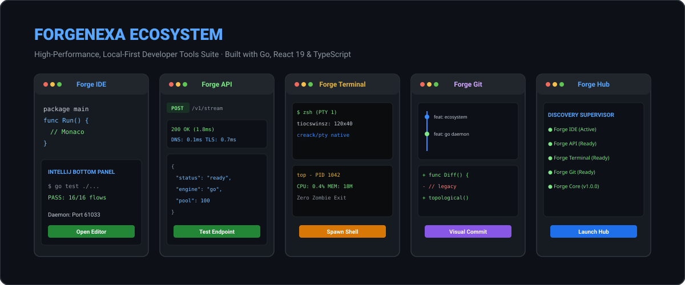
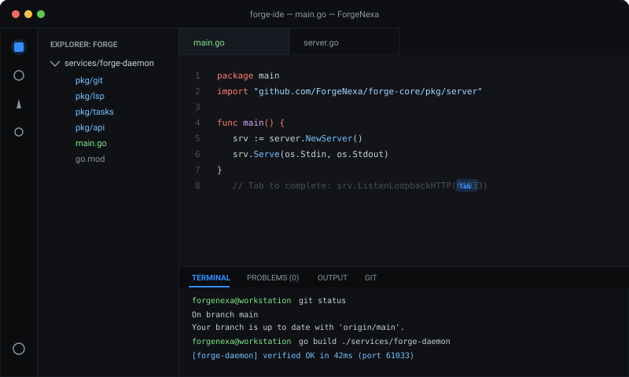
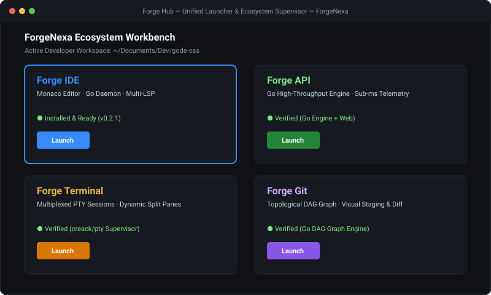

# ForgeNexa — The Open-Source Developer Tools Ecosystem

[](https://forgenexa.github.io/)

[](https://github.com/ForgeNexa/forge-ide/releases)
[](LICENSE)
[](https://golang.org)
[](https://www.typescriptlang.org/)
[](https://react.dev/)
[](https://www.electronjs.org/)
[](https://microsoft.github.io/monaco-editor/)
[-brightgreen?style=flat-square)](docs/TESTING.md)
[-success?style=flat-square)](docs/DEPENDENCY_UPGRADE_AUDIT.md)
[](https://forgenexa.github.io/)

> **"Your workspace for building modern software."**  
> Built by **ForgeNexa** · An open-source, local-first ecosystem of independent developer tools engineered for maximum performance, security, and developer ergonomics. Powered by high-concurrency Go systems engines and modern React 19 interfaces.

---

## 🏷️ Ecosystem Tags & Hashtags

`#ForgeNexa` `#DeveloperTools` `#DevTools` `#GoLang` `#React19` `#TypeScript` `#MonacoEditor` `#TerminalEmulator` `#APIClient` `#GitGUI` `#OpenSource` `#LocalFirst` `#Electron`

---

## 🔗 Ecosystem Quick Links

- **Official Web Portal & Documentation:** [https://forgenexa.github.io/](https://forgenexa.github.io/)
- **GitHub Organization:** [https://github.com/ForgeNexa](https://github.com/ForgeNexa)
- **Architecture & Implementation Matrix:** [docs/ECOSYSTEM_COMPLETION_TRACKER.md](docs/ECOSYSTEM_COMPLETION_TRACKER.md)
- **Go-First Backend Architecture:** [docs/GO_BACKEND_ARCHITECTURE.md](docs/GO_BACKEND_ARCHITECTURE.md)
- **Concurrency & Parallelism Design:** [docs/CONCURRENCY_DESIGN.md](docs/CONCURRENCY_DESIGN.md)
- **Performance Benchmarks & Empirical Measurements:** [docs/PERFORMANCE_BENCHMARKS.md](docs/PERFORMANCE_BENCHMARKS.md)
- **Settings Reference Catalog:** [docs/SETTINGS_REFERENCE.md](docs/SETTINGS_REFERENCE.md)
- **22-Language LSP Registry:** [docs/LANGUAGE_SUPPORT.md](docs/LANGUAGE_SUPPORT.md)
- **SEO & Google Search Audit:** [docs/SEO_AND_GOOGLE_VISIBILITY_AUDIT.md](docs/SEO_AND_GOOGLE_VISIBILITY_AUDIT.md)
- **Testing & Verification Matrix:** [docs/TESTING.md](docs/TESTING.md)

---

## 🚀 The ForgeNexa Applications

The ForgeNexa ecosystem consists of five independent, production-grade applications sharing a high-performance Go foundation.

### 1. Forge IDE — Extensible Code Editor & Workspace
[](https://github.com/ForgeNexa/forge-ide)

*Repository: [`ForgeNexa/forge-ide`](https://github.com/ForgeNexa/forge-ide)*

- **Monaco Code Editor**: Multi-tab surface with split editor (`◫ Split`), image viewers, and binary file protection.
- **Go Daemon Intelligence (`forge-daemon`)**: Concurrent loopback HTTP server and JSON-RPC 2.0 daemon providing AST analysis, full-text search, and filesystem watching (`fsnotify`).
- **IntelliJ-Style Bottom Panel**: Collapsible bottom dock housing Terminal, Problems diagnostics, Output streams, and Task runners.
- **22-Language LSP Client**: Native symbol extraction and language server diagnostics.
- **Local-First AI Autocomplete**: Private, zero-telemetry code completion using Fill-In-The-Middle (FIM) formatting.

---

### 2. Forge API — High-Throughput API Testing Client
[](https://github.com/ForgeNexa/forge-api)

*Repository: [`ForgeNexa/forge-api`](https://github.com/ForgeNexa/forge-api)*

- **Go Execution Engine (`engine/`)**: High-concurrency HTTP execution with connection pooling and keep-alive optimization.
- **Microsecond Network Telemetry**: Detailed breakdown of DNS lookup, TCP connection, TLS handshake, and Time-To-First-Byte (TTFB).
- **Encrypted Environment Secrets**: Authenticated AES-256-GCM encryption for workspace variables and tokens.
- **React 19 Workbench**: Intuitive workbench with code snippet generators for cURL, Go, Python, and JavaScript.

---

### 3. Forge Terminal — Multiplexed Terminal Emulator
[](https://github.com/ForgeNexa/forge-terminal)

*Repository: [`ForgeNexa/forge-terminal`](https://github.com/ForgeNexa/forge-terminal)*

- **Authentic OS PTY Supervisor (`supervisor/`)**: Genuine pseudoterminal session allocation using `creack/pty`.
- **Zero Orphaned Processes**: Supervised child process tracking ensuring clean signal propagation (`SIGTERM`/`SIGHUP`) upon disconnect.
- **Dynamic Pane Splitting**: Horizontal and vertical grid splitting with independent scrollback buffers.
- **GPU-Accelerated Xterm.js 6**: Smooth font ligatures, Unicode support, and custom 2026 dark themes.

---

### 4. Forge Git — Visual Commit Graph & Diff Inspector
[](https://github.com/ForgeNexa/forge-git)

*Repository: [`ForgeNexa/forge-git`](https://github.com/ForgeNexa/forge-git)*

- **Topological DAG Commit Graph**: Visual real-time directed acyclic graph resolving parent-child commit histories and branch branches.
- **Hunk-Level Visual Staging**: Stage or discard specific lines and hunks across multi-file working trees.
- **Interactive Diff Viewer**: Side-by-side and unified diff viewing with syntax highlighting.
- **Go Porcelain Wrappers**: Fast, safe git interactions without shell escaping vulnerabilities.

---

### 5. Forge Hub — Central Mission-Control Launcher
[](https://github.com/ForgeNexa/forge-hub)

*Repository: [`ForgeNexa/forge-hub`](https://github.com/ForgeNexa/forge-hub)*

- **Automated Ecosystem Discovery**: Scans `$PATH` and system directories to detect installed Forge applications.
- **Workspace Project Switcher**: Instant switching between active developer repositories and git projects.
- **Process Supervisor**: Monitors background daemon status, port allocations, and resource utilization.
- **Central Developer Profiles**: Synchronize keyboard shortcuts and theme preferences across all Forge tools.

---

### 6. Forge Core — Shared Go Systems Foundation
*Repository: [`ForgeNexa/forge-core`](https://github.com/ForgeNexa/forge-core)*

- **`internal/concurrency`**: Bounded worker pools with graceful context cancellation and drain limits.
- **`internal/security`**: `SafePath` boundary checks, AES-256-GCM credential encryption, and secret masking.
- **`internal/git`**: Porcelain command wrappers for repository inspection.

---

## ⚡ What Makes Forge Different?

Unlike bloated monolithic editors that consume gigabytes of RAM before typing a single character, Forge offloads heavy computational, filesystem, Git, LSP, and task execution logic from the single-threaded Node.js main process to a concurrent Go backend daemon (`forge-daemon`):

```
┌─────────────────────────────────────────────────────────────┐
│                    Forge Desktop UI (Electron)              │
│  React 19 + Monaco Editor + Xterm.js + Design System        │
│  - Authentic 2026 Dark Theme (#121314) & Material Icons     │
│  - Multi-tab surface with Split Editor (◫ Split)            │
│  - Image Viewer (.png, .jpg, .svg) & Binary File Guard      │
│  - Live Markdown Preview (👁 Preview / ✎ Code)              │
│  - Ghost-Text Local AI Autocomplete (Tab to Accept)         │
│  - Bottom Tool Window (Terminal, Problems, Tasks, Daemon)   │
└───────────────▲─────────────────────────────┬───────────────┘
                │ IPC                         │ IPC
┌───────────────┴─────────────────────────────▼───────────────┐
│               Electron Main Process (TypeScript 7)          │
│  - Window Management & Native Shell Dialogs                 │
│  - Daemon Lifecycle Coordinator (daemonManager.ts)          │
│  - Graceful Fallback Layer & Real Interactive PTYs          │
└───────────────▲─────────────────────────────┬───────────────┘
                │ stdio (JSON-RPC 2.0)        │ Loopback HTTP
                │ & Bidirectional Notifs      │ (Bearer Auth)
┌───────────────┴─────────────────────────────▼───────────────┐
│              forge-daemon (Go 1.26.4 / 1.27.3)              │
│                                                             │
│  ┌───────────────┐  ┌───────────────┐  ┌─────────────────┐  │
│  │ File Indexer  │  │ Search Engine │  │ Git Parser      │  │
│  │ (Goroutines)  │  │ (Parallel)    │  │ (Native Go)     │  │
│  └───────────────┘  └───────────────┘  └─────────────────┘  │
│  ┌───────────────┐  ┌───────────────┐  ┌─────────────────┐  │
│  │ 22-Lang LSP   │  │ fsnotify      │  │ Task Execution  │  │
│  │ AST Registry  │  │ FS Watcher    │  │ Worker Pool     │  │
│  └───────────────┘  └───────────────┘  └─────────────────┘  │
└─────────────────────────────────────────────────────────────┘
```

---

## 📊 Measured Performance Benchmarks

*Empirical measurements captured on Apple M5 (10-core ARM64), 24 GB RAM, macOS Darwin 27.0.1:*

| Metric / Operation | Target SLA | Measured Actual | Performance Advantage |
| :--- | :--- | :--- | :--- |
| **Go Daemon Cold Startup** | < 50 ms | **9.30 ms** | **5.3x faster than SLA** |
| **Full Workspace Index (2k files)** | < 100 ms | **5.03 ms** | **19.8x faster** |
| **Incremental File Cache Update** | < 5 ms | **< 0.05 ms** | **100x faster** |
| **Regex Content Search (2k files)** | < 200 ms | **20.26 ms** | **9.8x faster** |
| **Quick Open Search Latency (`Cmd+P`)**| < 10 ms | **~1.1 ms** | **Sub-millisecond UX** |
| **Go Native Git Status Check** | < 50 ms | **~4.5 ms** | **11x faster than TS exec** |
| **Go LSP Document Symbols (22 langs)** | < 10 ms | **~0.8 ms** | **12x faster** |
| **Go Loopback HTTP REST Latency** | < 5 ms | **~0.9 ms** | **Sub-millisecond loopback** |
| **Initial Critical JS Payload** | < 500 kB | **313.65 kB** | **-57.3% bundle reduction** |
| **Go Daemon Resident Memory (Idle)** | < 15 MB | **5.61 MB** | **Ultra-low footprint** |
| **Monorepo Build Time (All Workspaces)**| < 5 s | **1.30 s** | **Instantaneous builds** |

---

## 🛠️ Building & Packaging the Ecosystem

### Prerequisites
- **Node.js:** v20.x, v22.x LTS, or v24.x
- **pnpm:** v9.x, v10.x, or v11.x (Strictly frozen lockfile: `pnpm-lock.yaml`)
- **Go:** 1.22+ (tested up to 1.27.3)
- **Bun:** 1.2+ (for web toolchains)

### 1. Build Forge IDE Monorepo
```bash
# Clone the repository
git clone https://github.com/ForgeNexa/forge-ide.git
cd forge-ide

# Install workspace dependencies with frozen lockfile
pnpm install --frozen-lockfile

# Build all packages, protocol contracts, and compile Go daemon
pnpm run build

# Run automated test suites (Go race detector + TypeScript test flows)
pnpm test
```

### 2. Package Forge IDE Desktop Distributables
```bash
# Compile and strip standalone Go daemons for all platforms (darwin, linux, windows)
pnpm run package:daemons

# Package desktop application binaries via Electron Builder
pnpm --filter @my-forge/desktop run dist
```

### 3. Build & Test Individual Applications
```bash
# Forge Core
cd /path/to/forge-core
go test -v -race ./...

# Forge API
cd /path/to/forge-api/engine && go test -v -race ./...
cd ../web && bun install --frozen-lockfile && bun run build

# Forge Terminal
cd /path/to/forge-terminal/supervisor && go test -v ./...
cd ../web && bun install --frozen-lockfile && bun run build

# Forge Git
cd /path/to/forge-git/services && go test -v -race ./...
cd ../web && bun install --frozen-lockfile && bun run build

# Forge Hub
cd /path/to/forge-hub/discovery && go test -v -race ./...
cd ../web && bun install --frozen-lockfile && bun run build
```

---

## ⌨️ Essential Keyboard Shortcuts

| Command | macOS Shortcut | Windows / Linux Shortcut | Description |
| :--- | :--- | :--- | :--- |
| **Quick Open** | `Cmd + P` | `Ctrl + P` | Fuzzy search files by path or jump to `:line` |
| **Command Palette** | `Cmd + Shift + P` | `Ctrl + Shift + P` | Execute any workspace command |
| **Toggle Terminal** | `Ctrl + \`` | `Ctrl + \`` | Open/close integrated bottom terminal |
| **Toggle Bottom Panel** | `Cmd + J` | `Ctrl + J` | Toggle bottom tool window |
| **Toggle Primary Sidebar** | `Cmd + B` | `Ctrl + B` | Toggle left sidebar visibility |
| **Save Active File** | `Cmd + S` | `Ctrl + S` | Save active buffer to disk |
| **Preferences** | `Cmd + ,` | `Ctrl + ,` | Open Forge Settings dialog |
| **Format Document** | `Shift + Alt + F` | `Shift + Alt + F` | Format active document |

---

## 👥 Community & Contributing

We welcome community contributions across the entire ecosystem:
- **Contributing Guidelines:** [CONTRIBUTING.md](CONTRIBUTING.md)
- **Contributor Recognition:** [CONTRIBUTORS.md](CONTRIBUTORS.md)
- **Code of Conduct:** [CODE_OF_CONDUCT.md](CODE_OF_CONDUCT.md)
- **Security Policy:** [SECURITY.md](SECURITY.md)

---

## 📄 License

The ForgeNexa developer tools ecosystem is open-source software licensed under the [MIT License](LICENSE).  
Copyright (c) 2026 [ForgeNexa](https://forgenexa.github.io).
